<p align="center">
  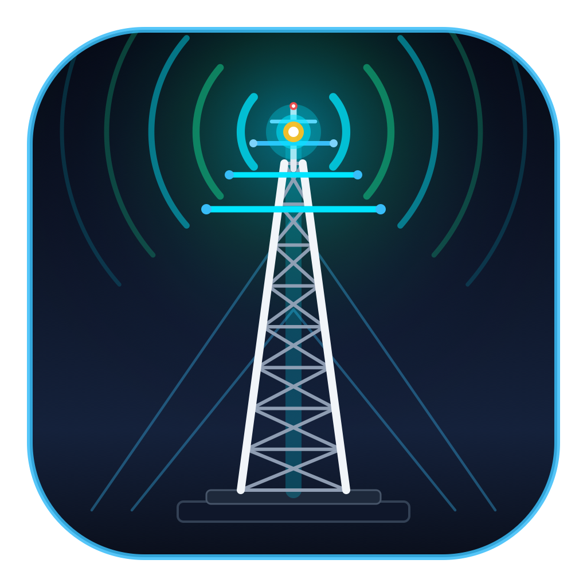
</p>

<h1 align="center">HamShack++</h1>

<p align="center">
  <strong>Native C++20 Unified Amateur Radio Communications & Digital Mode Workstation</strong><br/>
  <em>FLRig CAT • WSJT-X (FT8 / FT4) • JS8Call • Fldigi (CW) • ARDOP HF TNC • Pat / Winlink B2F Email • GridTracker • MeshCore++ LoRa BLE/USB • Libera.Chat IRC • Twitch Broadcast Studio</em>
</p>

<p align="center">
  <a href="https://github.com/andarazoroflove/HamShackPlusPlus/releases/latest">
    
  </a>
  
  
  
</p>

---

## Overview

**HamShack++** is a zero-dependency, native **C++20** amateur radio communications suite for **Windows x64** and **macOS Apple Silicon**. Rather than juggling half a dozen separate applications, virtual audio cables, and competing serial port bridges, HamShack++ unifies the essential digital-mode, rig-control, radio-email, mapping, and off-grid mesh programs into a single hardware-accelerated application with a persistent **FLRig / Xiegu G90 Top CAT Deck** and a **9-Tab Global Mode Bar**.

### Pre-Built Releases

Ready-to-run native packages are available in the [`releases/`](releases/) folder and on the [GitHub Releases](https://github.com/andarazoroflove/HamShackPlusPlus/releases) page:

| Platform | Package | Contents |
| :--- | :--- | :--- |
| **Windows x64** | [`releases/HamShack++-Windows-x64.zip`](releases/HamShack++-Windows-x64.zip) | Standalone static `HamShack++.exe` (Direct2D / DirectWrite / WASAPI / WinMM / WinRT BLE / WebView2) |
| **macOS Apple Silicon** | [`releases/HamShack++-macOS-AppleSilicon.zip`](releases/HamShack++-macOS-AppleSilicon.zip) | Native `arm64` `HamShack++.app` bundle (AppKit / CoreGraphics / CoreAudio / CoreBluetooth / WKWebView) |

---

## Integrated Programs & Subsystems

HamShack++ integrates and attributes the core DSP modems, protocols, and workflows of the following amateur radio software suites, with their corresponding headers organized in [`includes/`](includes/) and core application sources in [`src/`](src/):

### 1. FLRig — Xiegu G90 CI-V CAT Control & XML-RPC Server (`includes/flrig_cat.hpp`)
* **Persistent Top Rig Deck**: Remains live across every tab so you never lose sight of VFO A/B frequencies, operating mode (`LSB`, `USB`, `CW`, `CWR`, `AM`), filter width (`FIL1`–`FIL4`), S-Meter (`dBm` / S-units), RF Power output, or SWR.
* **Direct Xiegu G90 CI-V (`0x88`) Engine**: Auto-discovers USB-Serial CH340/CP210x/FTDI CAT ports at `19200 8N1` with instantaneous 1W steppers (`1W`–`20W`), `PTT`, `ATU TUNE`, `A/B`, `A->B`, `SPLIT`, `PRE`, `ATT`, `AGC`, `NB`, `CMP`, and 11 quick-QSY amateur band presets (`160m` through `6m`).
* **Built-in FLRig XML-RPC Server (`127.0.0.1:12345`)**: Exposes standard `rig.get_vfo`, `rig.set_vfo`, `rig.get_mode`, `rig.set_mode`, `rig.get_ptt`, `rig.set_ptt`, `rig.get_smeter`, and `rig.get_pwrmeter` endpoints for third-party logging tools.

---

### 2. WSJT-X — FT8 & FT4 Weak-Signal Workstation (`includes/modem_ft8_ft4.hpp`)
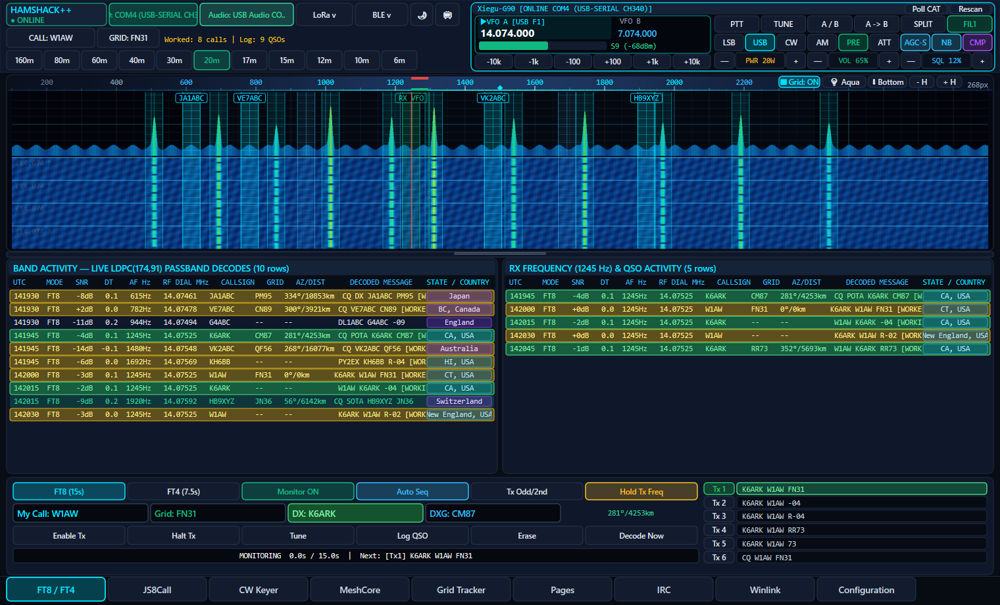

* **Full 77-Bit Protocol & `LDPC(174,91)` FEC**: Implements WSJT-X 77-bit message packing/unpacking (standard callsigns, directed `CQ DX` / `CQ POTA` / `CQ SOTA`, compound calls, grids, SNR reports, `RRR`, `RR73`, `73`), 14-bit CRC, Belief-Propagation `LDPC(174,91)` soft-decision decoding, and continuous-phase `8-GFSK` (FT8, 15.0s, 79 symbols) and `4-GFSK` (FT4, 7.5s, 105 symbols) synthesis.
* **Doubled Wide Graph Waterfall**: 8192-point FFT (`~0.97 Hz/bin`, 2880 bins across `100`–`2900 Hz`) with draggable top/bottom splitter, 5 waterfall color palettes, and click-to-QSY RX/TX markers.
* **Dual Activity Tables & Auto-Sequencer**: Side-by-side **Band Activity** and **RX Frequency** tables with automatic US State / DXCC Country badges, worked-callsign highlighting, double-click mid-slot opposite-period TX triggering, `Tx1`–`Tx6` sequencer, and WSJT-X `.adi` ADIF log import/export.

---

### 3. JS8Call — Weak-Signal Keyboard-to-Keyboard HF Messaging (`includes/modem_js8.hpp`)
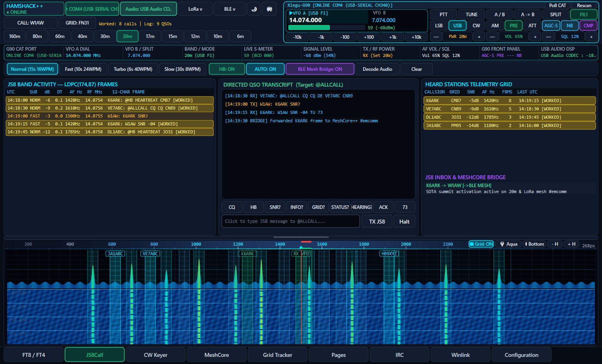

* **Four Costas 8-FSK Submodes**: Supports **Normal** (`15s`, `50 Hz`, `-24 dB`), **Fast** (`10s`, `80 Hz`, `-20 dB`), **Turbo** (`6s`, `160 Hz`, `-18 dB`), and **Slow** (`30s`, `25 Hz`, `-28 dB`) using `LDPC(174,87)` + `CRC-12` 12-character frame coding.
* **Directed Commands, Heartbeat & Relay**: Built-in support for `@HB` heartbeats, `@ALLCALL`, `SNR?`, `INFO?`, `GRID?`, `STATUS?`, `HEARD?`, `MSG`, `AGM`, and multi-hop `>RELAY` store-and-forward messaging.
* **HF ↔ MeshCore++ Bridge**: Automatically bridges directed JS8Call HF frames to and from off-grid MeshCore++ LoRa mesh channels.

---

### 4. Fldigi — CW Morse SOM Decoder, Digiscope & Keyer (`includes/modem_cw.hpp`)
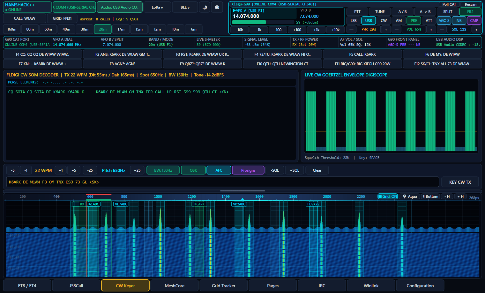

* **Self-Organizing Map (SOM) Morse Decoder**: Uses Fldigi's 7-weight Self-Organizing Map classifier paired with a Goertzel matched-filter detector and adaptive dot/dash hysteresis to track and decode CW signals from `5` to `60 WPM`.
* **Phase/Quadrature Digiscope & Waterfall**: Live CW envelope scope, narrowband pitch marker (`400`–`1000 Hz`), adjustable filter bandwidth (`50`–`500 Hz`), QSK, AFC, and prosign (`<AR>`, `<SK>`, `<BT>`, `<KN>`) support.
* **Raised-Cosine Keyer & 12 Contest Macros**: Generates click-free `4 ms` raised-cosine-shaped CW audio and provides 12 programmable macro buttons (`F1 CQ` through `F12 QRZ?`).

---

### 5. MeshCore++ — Off-Grid LoRa BLE & USB Tactical Mesh (`includes/crypto.hpp`, `includes/protocol.hpp`, `includes/transport.hpp`, `includes/image_encoder.hpp`)
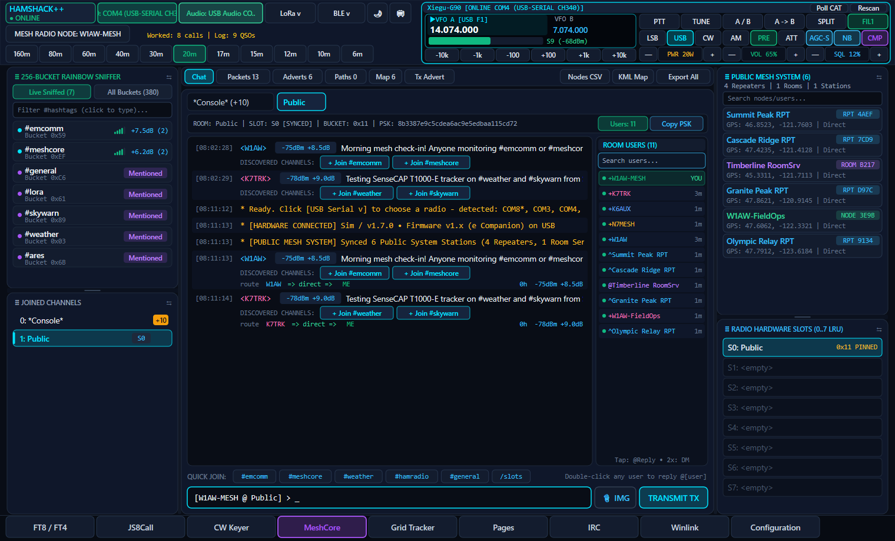

* **Dual-Transport Companion Radio Engine**: Connects to MeshCore LoRa radios over **USB Serial** (`115200 8N1`) or **Bluetooth Low Energy** (Nordic UART Service `6E400001-B5A3-F393-E0A9-E50E24DCCA9E`).
* **256-Bucket SHA-256 / AES-128 Rainbow Sniffer**: Precomputes channel key hashes across amateur, emergency, and regional `#hashtag` rooms to decrypt and route incoming group frames in real time.
* **Repeater Administration & 1-Bit Image Codec**: Remote repeater CLI (`/rlogin`, `/rcmd`, `/rstatus`, `/rtelemetry`, `/tracepath`), live multi-hop topology map with GPX/KML export, and `48x30` Floyd-Steinberg 1-bit tactical image transmission (`0x49`).

---

### 6. GridTracker & PSKReporter — Live Situational Awareness Map (`includes/dxcc_lookup.hpp`, `includes/psk_reporter.hpp`)
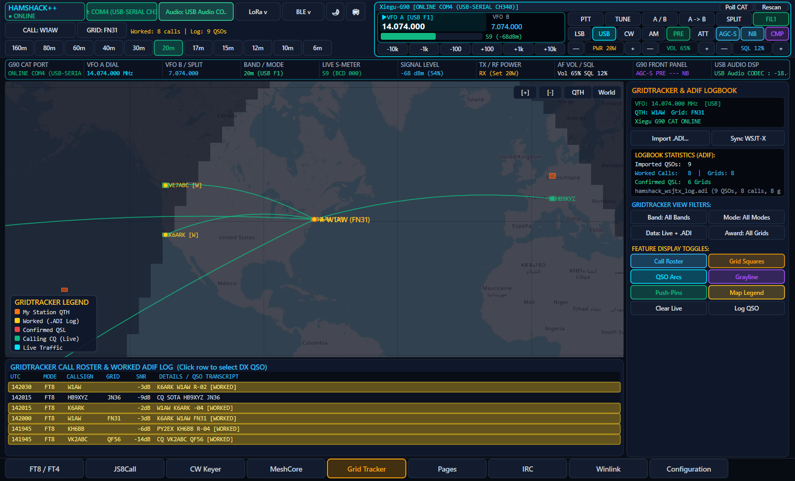

* **Interactive World Map & Maidenhead Grid Overlay**: Multi-zoom Web-Mercator map displaying 4-character Maidenhead grid squares (color-coded for **Worked** vs. **Confirmed QSL**), live solar grayline terminator, and great-circle QSO bearing arcs.
* **Real-Time Call Roster & Award Filters**: Filter spots by band (`160m`–`6m`), mode (`FT8/FT4`, `JS8Call`, `CW`), data source (`Live` vs. `Logbook .ADI`), and award overlay (`Maidenhead Grids`, `US States WAS`, `DXCC`, `CQ Zones`).
* **PSKReporter IPFIX Uploader**: Streams live decoded FT8, FT4, and JS8Call spots to `report.pskreporter.info:4739` using RFC 5101 IPFIX datagrams.

---

### 7. Amateur Radio Web Suite — QRZ, PSKReporter, DXView, DXLook & OpenHamClock (`src/web_maps_mac.hpp`)
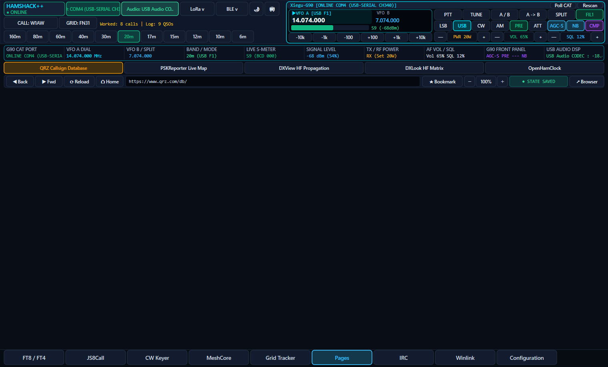

* **5 Persistent Native Browser Sub-Tabs**: Embeds hardware-accelerated **WebView2** (Windows) and **WKWebView** (macOS) views pre-bookmarked to **QRZ.com**, **PSKReporter.info**, **DXView.org**, **DXLook.com**, and **OpenHamClock.com** with independent per-page zoom persistence.

---

### 8. Libera.Chat IRC Client (`src/irc_client.hpp`)
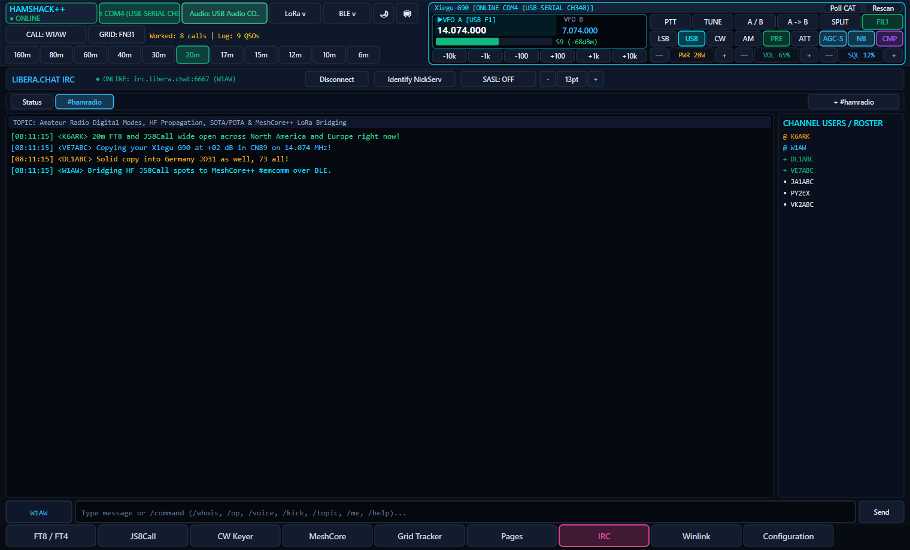

* **Integrated Multi-Channel Amateur Radio IRC**: Connects to `irc.libera.chat:6667` with optional **SASL PLAIN** authentication and automatic **NickServ** identification.
* **Operator Controls & Slash Commands**: Live sorted channel roster (`@` operators, `+` voiced users), right-click moderation menu (`Op`, `Voice`, `Whois`, `Direct Message`, `Kick`, `Ban`), dynamic font scaling, and full slash-command support (`/join`, `/part`, `/msg`, `/query`, `/whois`, `/topic`, `/mode`, `/me`, `/away`).

---

### 9. Pat / Winlink & ARDOP — Global Radio Email & 4,807 RMS Gateways (`includes/winlink_engine.hpp`, `includes/winlink_gateways_data.hpp`, `includes/ardop_modem.hpp`)
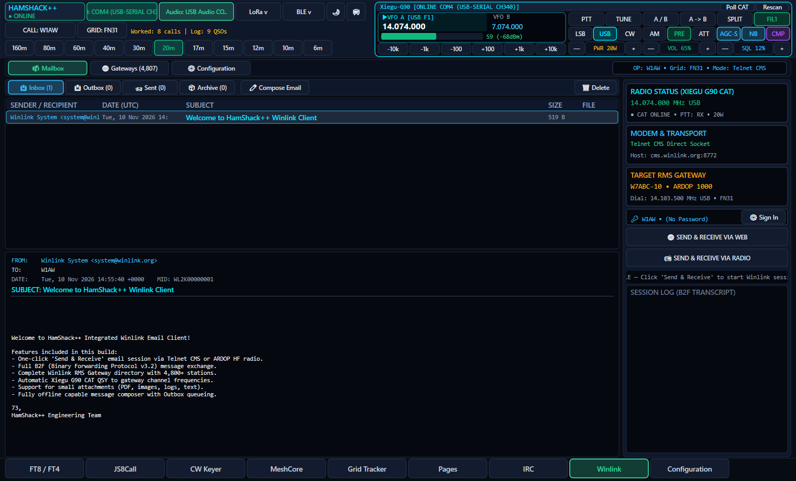

* **Full B2F v3.2 Binary Forwarding Protocol**: Native implementation of Winlink's B2F protocol (`F>` proposal negotiation, `FS` responses, LZHUF compression, binary attachment framing, and checksum verification) across **Inbox**, **Outbox**, **Sent**, and **Archive** mailboxes.
* **Built-in In-Process ARDOP HF Soundcard TNC (`127.0.0.1:8515`)**: Eliminates external TNC executables by running an integrated ARDOP modem (`500 Hz`, `1000 Hz`, `2000 Hz` bandwidths) tied directly to the soundcard and Xiegu G90 CAT PTT.

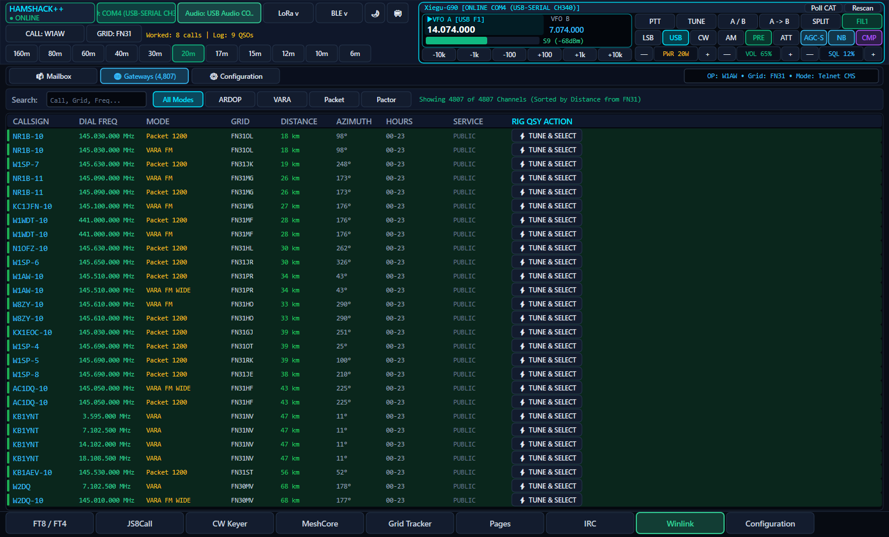

* **4,807 Global HF/VHF RMS Gateway Directory**: Searchable offline database of 4,807 Winlink RMS gateways worldwide with Maidenhead grid distance/bearing calculation and **1-click Xiegu G90 CAT QSY**.

---

### 10. Configuration, Soundcard DSP & Twitch Broadcast Studio (`src/hamshack_config.hpp`, `src/soundcard_audio.hpp`, `src/twitch_streamer.hpp`)
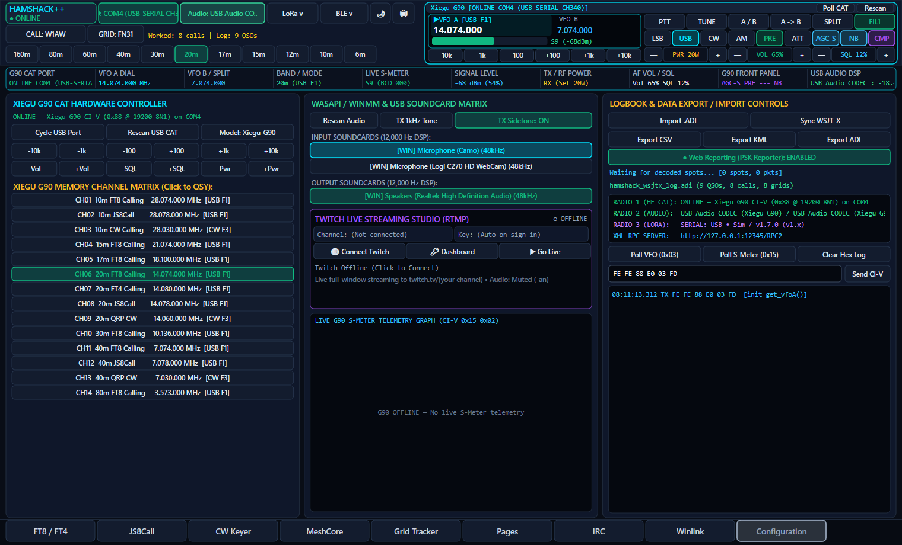

* **Cross-Platform 12 kHz Soundcard DSP Engine**: Native **CoreAudio** (macOS) and **WASAPI + WinMM** (Windows) audio engine with automatic `USB Audio CODEC` discovery, live RMS/Peak dBFS metering, and adjustable RX/TX gain.
* **Twitch Live Broadcast Studio**: Streams the live HamShack++ window to Twitch (`rtmp://live.twitch.tv/app/`) via FFmpeg using direct RGBA memory-pipe capture and digital silence (`anullsrc`) so your microphone, camera, and radio soundcard remain 100% isolated.

---

## Repository Structure

```text
HamShackPlusPlus/
├── src/                        # Core HamShack++ C++20 source & platform files
│   ├── hamshack_gui.cpp        # Main application entry point, Direct2D/AppKit renderer & MeshCore++ UI
│   ├── hamshack_tabs.hpp       # Unified FLRig top deck & 9-mode workstation tab views
│   ├── hamshack_config.hpp     # Persistent station configuration & profile manager
│   ├── hamshack_platform.hpp   # Cross-platform POSIX / Winsock2 & filesystem abstraction
│   ├── soundcard_audio.hpp     # 12 kHz CoreAudio / WASAPI+WinMM DSP audio & FFT waterfall engine
│   ├── irc_client.hpp          # Native Libera.Chat IRC, SASL PLAIN & NickServ client engine
│   ├── twitch_streamer.hpp     # Hardware-isolated FFmpeg RTMP Twitch broadcast studio
│   ├── web_maps_mac.hpp        # Native Edge WebView2 (Windows) & WKWebView (macOS) browser engine
│   ├── gen_icon.cpp            # Procedural icon generator
│   ├── hamshack_resource.rc    # Windows PE64 icon & version resource definition
│   ├── AppIcon.ico             # Windows application icon
│   ├── AppIcon.png             # High-resolution application icon
│   ├── AppIcon.icns            # macOS bundle icon
│   ├── Info.plist              # macOS bundle metadata
│   └── entitlements.plist      # macOS audio & Bluetooth LE entitlements
├── includes/                   # Integrated upstream/companion program headers & modems
│   ├── flrig_cat.hpp           # FLRig Xiegu G90 CI-V CAT engine & XML-RPC server (127.0.0.1:12345)
│   ├── modem_ft8_ft4.hpp       # WSJT-X FT8/FT4 8-GFSK/4-GFSK modem, 77-bit codec & LDPC(174,91)
│   ├── modem_js8.hpp           # JS8Call Costas 8-FSK Normal/Fast/Turbo/Slow modem & relay engine
│   ├── modem_cw.hpp            # Fldigi CW Morse SOM decoder, Goertzel detector & raised-cosine keyer
│   ├── ardop_modem.hpp         # ARDOP HF soundcard TNC modem server (127.0.0.1:8515)
│   ├── winlink_engine.hpp      # Pat / Winlink B2F v3.2 global radio email engine
│   ├── winlink_gateways_data.hpp # Offline directory of 4,807 global Winlink HF/VHF RMS gateways
│   ├── psk_reporter.hpp        # GridTracker / PSKReporter IPFIX (RFC 5101) UDP spot uploader
│   ├── dxcc_lookup.hpp         # GridTracker Maidenhead grid, US State & ITU DXCC entity resolver
│   ├── crypto.hpp              # MeshCore++ SHA-256, AES-128 & 256-bucket Rainbow Sniffer
│   ├── protocol.hpp            # MeshCore++ companion radio framing & 0x49 1-bit bitmap protocol
│   ├── transport.hpp           # MeshCore++ USB Serial & CoreBluetooth / WinRT BLE NUS transport
│   ├── image_encoder.hpp       # MeshCore++ Floyd-Steinberg 1-bit dithered tactical image codec
│   └── macos_d2d_shim.hpp      # MeshCore++ macOS CoreGraphics / CoreText Direct2D compatibility layer
├── releases/                   # Pre-built native release archives
│   ├── HamShack++-Windows-x64.zip
│   └── HamShack++-macOS-AppleSilicon.zip
└── screenshots/                # Live interface screenshots across all 9 operating modes
```

---

## Credits & Upstream Acknowledgements

HamShack++ stands on the shoulders of the open-source amateur radio community and integrates protocols, algorithms, and architectures pioneered by:

* **[WSJT-X](https://wsjt.sourceforge.io/)** — Joe Taylor (`K1JT`), Steve Franke (`K9AN`), Bill Somerville (`G4WJS`), and the WSJT Development Group (FT8 / FT4 protocols, 77-bit message packing, and `LDPC(174,91)` FEC).
* **[JS8Call](http://js8call.com/)** — Jordan Sherer (`KN4CRD`) (JS8 Costas 8-FSK submodes, directed commands, heartbeat networking, and relay protocols).
* **[Fldigi](http://www.w1hkj.com/)** & **[FLRig](http://www.w1hkj.com/)** — Dave Freese (`W1HKJ`) and associates (CW Self-Organizing Map decoding, Goertzel matched filtering, Xiegu G90 CI-V rig control, and XML-RPC CAT interface).
* **[ARDOP](https://github.com/pflarue/ardop)** — Rick Muething (`KN6KB`), John Wiseman (`G8BPQ`), and Peter LaRue (`AI7YN`) (Amateur Radio Digital Open Protocol HF soundcard TNC interface).
* **[Pat Winlink](https://getpat.io/)** — Martin Hebnes Pedersen (`LA5NTA`) and the Winlink Development Team (B2F Binary Forwarding Protocol v3.2 and RMS Gateway directory integration).
* **[GridTracker](https://gridtracker.org/)** & **[PSKReporter](https://pskreporter.info/)** — Stephen Loomis (`N0TTL`), Philip Gladstone (`N1DQ`), and the GridTracker team (Maidenhead grid visualization, QSO path arcs, and IPFIX UDP 4739 spot reporting).
* **[MeshCore](https://meshcore.co.uk/)** — Scott Powell and the MeshCore community (LoRa companion radio protocol, BLE NUS transport, and `#hashtag` group encryption).
